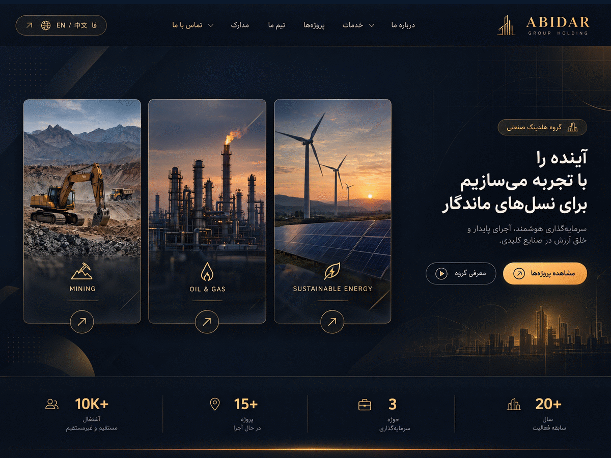

# گروه هلدینگ آبیدر — قالب وردپرس شرکتی و صنعتی

قالب وردپرس اختصاصی، حرفه‌ای و کاملاً فارسی (RTL) برای هلدینگ صنعتی **گروه آبیدر** در حوزه‌های **معادن، انرژی و نفت، گاز و پتروشیمی**.

نسخه: `2.2.2` — سازگار با وردپرس `6.4+` و PHP `8.0+` — مبتنی بر **المنتور رایگان (Elementor Free)**؛ بدون نیاز به هیچ قابلیت یا افزونه‌ی پولی.

<p align="center">
  
</p>

---

## فهرست

1. [ویژگی‌های کلیدی](#ویژگی‌های-کلیدی)
2. [نصب و راه‌اندازی سریع](#نصب-و-راه‌اندازی-سریع)
3. [پنل تنظیمات قالب (۸ تب)](#پنل-تنظیمات-قالب-۸-تب)
4. [یکپارچه‌سازی المنتور رایگان](#یکپارچه‌سازی-المنتور-رایگان)
5. [۱۰ المان اختصاصی المنتور](#۱۰-المان-اختصاصی-المنتور)
6. [سیستم چندزبانه هوشمند](#سیستم-چندزبانه-هوشمند)
7. [ماژول امنیت پیشرفته](#ماژول-امنیت-پیشرفته)
8. [دکمه شناور ارتباط چندبخشی](#دکمه-شناور-ارتباط-چندبخشی)
9. [ناوبری موبایل (۴ چیدمان)](#ناوبری-موبایل-۴-چیدمان)
10. [ساختار پوشه‌ها و فایل‌ها](#ساختار-پوشه‌ها-و-فایل‌ها)
11. [قالب‌های برگه و نوشته](#قالب‌های-برگه-و-نوشته)
12. [پست‌تایپ‌های اختصاصی و فیلدهای متا](#پست‌تایپ‌های-اختصاصی-و-فیلدهای-متا)
13. [توسعه‌دهندگان: توابع و قراردادها](#توسعه‌دهندگان-توابع-و-قراردادها)
14. [دسترس‌پذیری، کارایی و SEO](#دسترس‌پذیری-کارایی-و-seo)
15. [پرسش‌های متداول و عیب‌یابی](#پرسش‌های-متداول-و-عیب‌یابی)
16. [تغییرات نسخه](#تغییرات-نسخه)
17. [مجوز](#مجوز)

---

## ویژگی‌های کلیدی

| حوزه | توضیح |
| --- | --- |
| **طراحی** | هویت بصری «صنعتی–لوکس» با پالت سرمه‌ای `#0B192C` و کهربایی `#D97706`؛ تایپوگرافی فارسی اختصاصی (Vazirmatn) با فونت قابل آپلود از پیشخوان |
| **المنتور** | ۱۰ المان اختصاصی با ۳۲ چیدمان قابل تعویض زنده (۳ تا ۴ طرح برای هر المان)، هدرساز و فوترساز کامل — تنها با المنتور **رایگان** |
| **چندزبانه** | فارسی (RTL)، انگلیسی و چینی به‌صورت پیش‌فرض + افزودن بی‌نهایت زبان جدید از پیشخوان بدون ویرایش کد |
| **امنیت** | تغییر آدرس ورود، محدودیت تلاش ورود، Honeypot + Time-Trap + کپچای ریاضی، هدرهای امنیتی و گزارش زنده رویدادها |
| **ارتباط سریع** | دکمه شناور چندبخشی با انتخاب معاونت/دپارتمان مقصد و هدایت به فرم تماس با دپارتمان از پیش انتخاب‌شده |
| **موبایل** | ناوبری اختصاصی موبایل با ۴ چیدمان و نوار پایین صفحه |
| **دمو** | ساخت خودکار ۷ برگه اصلی + داده‌های المنتور + نمونه‌های خدمات، پروژه‌ها، تیم، مدارک و مقالات با یک کلیک |
| **کارایی** | CSS و JS خالص و بدون وابستگی سنگین؛ بارگذاری شرطی منابع، `loading="lazy"`، انیمیشن‌های سبک و احترام به `prefers-reduced-motion` |
| **دسترس‌پذیری** | اسکیپ‌لینک، مدیریت فوکوس در منو و مودال، `aria-*` کامل، کنتراست منطبق با WCAG AA و پشتیبانی از کیبورد |

---

## نصب و راه‌اندازی سریع

### ۱) نصب قالب

```bash
# از ریشه مخزن، یک بسته نصبی بسازید
zip -r abidar-group-holding.zip . \
  -x ".git/*" -x "node_modules/*" -x "*.zip"
```

سپس در پیشخوان وردپرس: **نمایش ← پوسته‌ها ← افزودن پوسته ← بارگذاری پوسته** و فایل `abidar-group-holding.zip` را نصب و فعال کنید.

> نیازمندی‌ها: وردپرس ۶.۴ یا بالاتر، PHP 8.0 یا بالاتر.
> افزونه‌های پیشنهادی: **Elementor** (رایگان)، **Rank Math** یا **Yoast SEO** (اختیاری).

### ۲) فعال‌سازی افزونه المنتور

**افزونه‌ها ← افزودن ← جست‌وجوی «Elementor» ← نصب ← فعال‌سازی.**
پس از فعال‌سازی، دو دسته‌بندی اختصاصی در پنل المنتور ظاهر می‌شود:

- `هدر و فوتر ساز گروه آبیدر (Elementor Free)`
- `المان‌های اختصاصی هلدینگ آبیدر (معادن، انرژی، نفت)`

### ۳) ساخت خودکار ۷ برگه دمو

به **گروه آبیدر ← ۸. ساخت دمو و برگه‌های المنتور** بروید و دکمه زیر را بزنید:

> **«ساخت و بازسازی تمام برگه‌های دمو المنتور و محتوای نمونه»**

این عملیات به‌طور خودکار:

- ۷ برگه اصلی را می‌سازد یا بازسازی می‌کند: **صفحه اصلی، درباره ما، خدمات، پروژه‌ها، تیم ما، مدارک و اسناد، تماس با ما**
- قالب برگه اختصاصی هر صفحه (`page-templates/template-*.php`) را تخصیص می‌دهد
- ساختار JSON استاندارد المنتور (`_elementor_data`) را روی هر برگه می‌نویسد تا صفحه بلافاصله در ویرایشگر المنتور قابل ویرایش باشد
- صفحه اصلی را به‌عنوان صفحه نخست (`page_on_front`) تنظیم می‌کند
- نمونه‌های خدمات، پروژه‌ها، اعضای تیم، مدارک و مقالات را در پست‌تایپ‌ها ایجاد می‌کند

عملیات **تکرارپذیر (idempotent)** است؛ اجرای مجدد سبب ایجاد داده‌های تکراری نمی‌شود.

### ۴) تنظیم صفحه نوشته‌ها

**تنظیمات ← خواندن** ← «صفحه نوشته‌ها» را روی برگه «مقالات» (یا هر برگه دلخواه) تنظیم کنید. لینک‌های «مقالات و اخبار» در هدر و فوتر به‌صورت خودکار به همین برگه اشاره می‌کنند.

### ۵) (اختیاری) ساخت هدر/فوتر با المنتور

1. **هدر و فوتر ساز (المنتور) ← ساخت هدر یا فوتر جدید**
2. در متاباکس کناری «نوع قالب» را روی `header` یا `footer` بگذارید و منتشر کنید
3. در **گروه آبیدر ← ۱. طرح و چیدمان و فونت**، «چیدمان هدر» یا «چیدمان فوتر» را روی `ساخت اختصاصی با المنتور` قرار دهید

اگر این گزینه غیرفعال بماند، هدر/فوتر پیش‌فرض قالب (۴ و ۳ چیدمان) رندر می‌شود.

---

## پنل تنظیمات قالب (۸ تب)

مسیر: **پیشخوان ← گروه آبیدر** (منوی اختصاصی با آیکون هلدینگ)

| تب | تنظیمات |
| --- | --- |
| **۱. طرح و چیدمان و فونت** | حالت چیدمان (Wide / Boxed)، عرض محتوا، رنگ‌های اصلی/ثانویه/تأکیدی (با `wp-color-picker`)، فونت اختصاصی (بارگذاری WOFF2/WOFF/TTF)، لوگوی هدر و فوتر (کتابخانه رسانه)، چیدمان هدر (۴ طرح + المنتور)، چیدمان فوتر (۳ طرح + المنتور) |
| **۲. ناوبری موبایل** | چیدمان منوی موبایل (۴ حالت)، فعال‌سازی نوار پایین صفحه، نمایش/مخفی‌سازی دکمه‌ها، انتخاب منوی وردپرس |
| **۳. دکمه شناور تماس** | حالت نمایش، موقعیت صفحه، شماره تماس مستقیم، آیدی واتساپ، آیدی تلگرام، مجموعه معاونت‌ها/دپارتمان‌ها (Repeater) |
| **۴. قالب مقاله و پست‌ها** | چیدمان آرشیو، نمایش سایدبار، نمایش مسیر راهبری (Breadcrumb)، فهرست مطالب (TOC)، نوار پیشرفت مطالعه، جعبه اشتراک‌گذاری، مقالات مرتبط |
| **۵. پیش‌بارگذاری سایت** | فعال/غیرفعال، ۴ سبک پیش‌بارگذار (نبض، مدار، نوار پیشرفت، لوگو)، حداکثر زمان نمایش، سرعت انتقال |
| **۶. امنیت پیشرفته** | آدرس ورود سفارشی، فعال‌سازی قفل ورود، حداکثر تلاش مجاز، مدت مسدودسازی، لیست سفید IP، Honeypot، Time-Trap، کپچای ریاضی، مسدودسازی XML-RPC، جلوگیری از افشای کاربران، هدرهای امنیتی، **جدول گزارش زنده رویدادها** |
| **۷. زبان‌های سایت** | انتخاب زبان پیش‌فرض، افزودن زبان جدید (کد، نام، نام بومی، پرچم، جهت `rtl`/`ltr`، فعال/غیرفعال) — دکمه «افزودن زبان جدید» ردیف جدید می‌سازد |
| **۸. ساخت دمو** | دکمه نمونه‌ساز خودکار ۷ برگه + گزارش نتیجه به‌صورت AJAX |

> تمام تنظیمات در یک آپشن واحد (`abidar_theme_options_v2`) با نام `abidar[...]` ذخیره می‌شوند؛ ذخیره‌سازی با `nonce`، بررسی `manage_options` و پاک‌سازی کامل انجام می‌گیرد.

---

## یکپارچه‌سازی المنتور رایگان

این قالب هیچ‌جا از APIهای المنتور **Pro** استفاده نمی‌کند.

- ثبت دسته‌بندی اختصاصی ویجت‌ها در ویرایشگر
- ثبت ویجت‌ها با قلاب `elementor/widgets/register` (سازگار با المنتور ۳.۵+ و ۳.۲۵+)
- افزودن پست‌تایپ‌های `abidar_hf`، `abidar_service` و `abidar_project` به پست‌تایپ‌های قابل ویرایش با المنتور
- **اعلان تنبل (Lazy) کلاس پایه:** کلاس `Abidar_Elementor_Widget_Base` فقط در لحظه بارگذاری فایل‌های ویجت و پس از بررسی `class_exists( '\Elementor\Widget_Base' )` اعلان می‌شود. هرگز از `did_action( 'elementor/loaded' )` برای این تشخیص استفاده نمی‌شود، زیرا آن اکشن روی قلاب `init` اجرا می‌شود و در زمان بارگذاری پوسته همیشه مقدار `false` دارد.
- **مسیر جانشین امن:** اگر المنتور نصب نباشد، نسخه سبک کلاس پایه اعلان می‌شود تا هدر، فوتر و سایر ویجت‌های داخلی قالب همچنان رندر شوند.
- **محافظ نهایی در ثبت:** پیش از `register()`، هر نمونه با `$instance instanceof \Elementor\Widget_Base` بررسی می‌شود تا هرگز خطای `TypeError` رخ ندهد.
- **بارگذاری تضمینی در رندر:** `render_site_header()`/`render_site_footer()` پیش از رندر، کلاس‌های ویجت را بارگذاری می‌کنند و در صورت نبود کلاس، یک هدر/فوتر ساده جانشین نمایش می‌دهند (هرگز صفحه سفید).
- استفاده از `get_builder_content_for_display()` برای رندر هدر/فوتر ساخته‌شده با المنتور
- کنترل‌های استایل (`Style Controls`) روی تمام ویجت‌ها: رنگ، تایپوگرافی، فاصله‌گذاری

---

## ۱۰ المان اختصاصی المنتور

| # | ویجت | چیدمان‌ها |
| --- | --- | --- |
| ۱ | **هدر و مگامنوی گروه آبیدر** | ۴ چیدمان (+ نوار بالایی، مبدل زبان، دکمه CTA، مگامنو) |
| ۲ | **فوتر جامع هلدینگ** | ۳ چیدمان |
| ۳ | **هیرو و ویترین ۳ حوزه** | ۳ چیدمان + ستون‌های تعاملی معدن/انرژی/نفت |
| ۴ | **خدمات هلدینگ** | ۴ چیدمان (`کارت سه‌بعدی`، `تب تعاملی`، `آکاردئون`، `ماتریس بنتو`) + فیلتر حوزه فعالیت |
| ۵ | **پروژه‌های هلدینگ** | ۴ چیدمان (`گرید فنی`، `اسپات‌لایت`، `افقی`، `گالری`) + فیلتر حوزه فعالیت |
| ۶ | **تیم و هیئت مدیره** | ۴ چیدمان (`کارت مدیران`، `چارت رهبری`، `پرتره مدرن`، `رزومه افقی`) |
| ۷ | **مدارک، استانداردها و لوح‌ها** | ۳ چیدمان + مودال استعلام اصالت |
| ۸ | **درباره ما، ESG و خط زمانی** | ۴ چیدمان |
| ۹ | **تماس با ما و دایرکتوری معاونت‌ها** | ۳ چیدمان + فرم امن ضد اسپم |
| ۱۰ | **تغییر زبان هوشمند** | ۳ سبک (`pills_flag`، `compact_iso`، `dropdown`) |

**تعویض چیدمان:** کلیدهای «طرح ۱ … طرح ۴» در بالای هر بخش، صفت `data-active-layout` را روی `<section>` تغییر می‌دهند و CSS بلافاصله چیدمان جدید را اعمال می‌کند — بدون بارگذاری مجدد صفحه.
برای پنهان‌کردن این کلیدها در سایت نهایی، در تنظیمات ویجت گزینه «نمایش کلیدهای تغییر طرح» را خاموش کنید.

---

## سیستم چندزبانه هوشمند

### زبان‌های پیش‌فرض

| کد | زبان | جهت | پرچم |
| --- | --- | --- | --- |
| `fa` | فارسی | RTL | 🇮🇷 |
| `en` | English | LTR | 🇬🇧 |
| `zh` | 中文 (简体) | LTR | 🇨🇳 |

دیکشنری هر سه زبان کامل است (۸۰ کلید در هر زبان، بدون کلید گم‌شده).

### افزودن زبان جدید

**گروه آبیدر ← ۷. زبان‌های سایت** ← دکمه «افزودن زبان جدید» ← تکمیل کد زبان (مثلاً `ar` یا `ru`)، نام بومی، پرچم، جهت و وضعیت فعال ← ذخیره.

برای ترجمه عبارات یک زبان سفارشی، کلیدهای دیکشنری را در آرایه `translations` آن زبان (از طریق فیلتر `abidar_language_translations`) مقداردهی کنید:

```php
add_filter( 'abidar_language_translations', function ( $translations, $lang ) {
	if ( 'ar' === $lang ) {
		$translations['nav_home']     = 'الرئيسية';
		$translations['nav_about']    = 'من نحن';
		$translations['nav_services'] = 'خدماتنا';
	}
	return $translations;
}, 10, 2 );
```

### نحوه تعیین زبان

- با پارامتر `?lang=en` در آدرس (کوکی یک‌ساله تنظیم می‌شود)
- با کوکی `abidar_lang` در بازدیدهای بعدی
- مقدار پیش‌فرض از تنظیمات قالب خوانده می‌شود

زبان فعلی به‌صورت خودکار روی `<html lang dir>`، کلاس‌های `<body>` و استایل‌های `rtl.css` اعمال می‌شود.

### محتوای چندزبانه پست‌تایپ‌ها

هر خدمت، پروژه، عضو تیم و مدرک دارای فیلدهای متای `_abidar_title_en`، `_abidar_title_zh`، `_abidar_desc_en`، `_abidar_desc_zh`، `_abidar_role_en`، `_abidar_role_zh`، `_abidar_dept_fa/en/zh` و … است. تابع `abidar_multilang_val()` به‌ترتیب زیر مقدار را انتخاب می‌کند:

1. مقدار زبان جاری (مثلاً `title_en`)
2. اگر زبان جاری فارسی باشد، کلید بدون پسوند (`title`) که در داده‌های پیش‌فرض فارسی است
3. مقدار انگلیسی، سپس فارسی، سپس کلید بدون پسوند
4. مقدار بازگشتی (fallback)

---

## ماژول امنیت پیشرفته

مسیر تنظیمات: **گروه آبیدر ← ۶. امنیت پیشرفته**

| قابلیت | توضیح |
| --- | --- |
| **آدرس ورود سفارشی** | جایگزینی `wp-login.php` با آدرس دلخواه (پیش‌فرض `abidar-secure-gateway`)؛ دسترسی مستقیم به `wp-login.php` با خطای 403 مسدود و ثبت می‌شود |
| **محدودیت تلاش ورود** | قفل موقت بر اساس IP پس از تعداد تلاش ناموفق قابل تنظیم (پیش‌فرض ۵ تلاش / ۳۰ دقیقه) |
| **پوشاندن خطاهای ورود** | پیام یکسان برای نام کاربری نامعتبر و گذرواژه اشتباه (مقابله با شمارش کاربران) |
| **Honeypot** | فیلد مخفی که تنها ربات‌ها آن را پر می‌کنند |
| **Time-Trap** | رد کردن ارسال‌های فوق‌سریع (کمتر از ۳ ثانیه) با امضای `wp_hash` |
| **کپچای ریاضی فارسی** | پرسش عددی با هش امن سمت سرور (بدون نیاز به سرویس خارجی یا کلید API) |
| **XML-RPC** | غیرفعال‌سازی کامل + حذف هدر `X-Pingback` |
| **افشای کاربران** | محدودسازی `?author=` و endpointهای کاربر در REST API |
| **هدرهای امنیتی** | `X-Content-Type-Options`، `X-Frame-Options`، `Referrer-Policy`، `Permissions-Policy`، `X-XSS-Protection` |
| **گزارش رویدادها** | جدول زنده رویدادهای امنیتی (نوع، شرح، IP، زمان) در تب ۶ |

فیلدهای ضد اسپم فقط از یک منبع رندر می‌شوند: `Abidar_Security::render_antispam_fields()` — هم در فرم تماس اختصاصی و هم در فرم دیدگاه‌ها.
اعتبارسنجی سمت سرور: `Abidar_Security::verify_submission_security( $payload )`.

---

## دکمه شناور ارتباط چندبخشی

- دکمه شناور با پالس ملایم در گوشه صفحه (قابل تنظیم: راست/چپ)
- با کلیک، هاب ارتباطی باز می‌شود: **تماس تلفنی، واتساپ، تلگرام، فرم تماس**
- فهرست معاونت‌ها/دپارتمان‌ها از تنظیمات (Repeater) خوانده می‌شود
- انتخاب هر دپارتمان، کاربر را به بخش تماس با پارامتر `?dept=…` هدایت می‌کند و همان دپارتمان در فرم از پیش انتخاب می‌شود
- دسترس‌پذیری کامل: `aria-expanded`، بستن با `Esc`، تله فوکوس و بازگشت فوکوس به دکمه

---

## ناوبری موبایل (۴ چیدمان)

| چیدمان | توضیح |
| --- | --- |
| `drawer` | کشوی کناری تمام‌قد با انیمیشن نرم |
| `fullscreen` | منوی تمام‌صفحه با تایپوگرافی درشت |
| `sheet` | شیت پایین‌کشیدنی (Bottom Sheet) |
| `accordion` | آکاردئون چندسطحی با زیرمنوها |

به‌همراه **نوار پایین صفحه (Bottom Bar)** اختیاری با میان‌برهای تماس، واتساپ، جست‌وجو و منو.
مدیریت فوکوس، بستن با `Esc`، جلوگیری از اسکرول بدنه و `aria-hidden` به‌درستی اعمال می‌شود.

---

## ساختار پوشه‌ها و فایل‌ها

```text
abidar-group-holding/
├── style.css                  # هدر قالب + توکن‌های طراحی هسته (سبک و مینیمال)
├── rtl.css                    # استایل‌های راست‌به‌چپ (بارگذاری شرطی)
├── theme.json                 # پالت رنگ، تایپوگرافی و عرض محتوا برای ویرایشگر بلوکی
├── functions.php              # ثابت‌ها، پیش‌فرض‌ها، راه‌اندازی، کمکی‌های قالب
├── screenshot.png             # پیش‌نمایش قالب (1200×900)
├── header.php / footer.php    # پوسته هدر/فوتر (رندر هدر و فوتر المنتور یا ویجت اختصاصی)
├── front-page.php             # صفحه نخست
├── page.php / index.php       # برگه و آرشیو کلاسیک
├── single.php                 # نوشته‌ها
├── archive.php / search.php / 404.php / comments.php
├── single-abidar_project.php      # پروژه
├── single-abidar_service.php      # خدمت
├── single-abidar_team.php         # عضو تیم
├── single-abidar_certificate.php  # مدرک
├── page-templates/            # ۸ قالب برگه
│   ├── template-home.php
│   ├── template-about.php
│   ├── template-services.php
│   ├── template-projects.php
│   ├── template-team.php
│   ├── template-certificates.php
│   ├── template-contact.php
│   └── template-blog.php
├── inc/
│   ├── class-abidar-i18n.php            # موتور چندزبانه (FA/EN/ZH + زبان‌های سفارشی)
│   ├── class-abidar-cpt.php             # پست‌تایپ‌ها، تاکسونومی‌ها و متاباکس‌ها
│   ├── class-abidar-security.php        # ماژول امنیت و ضد اسپم
│   ├── class-abidar-dynamic-css.php     # تولید CSS پویا از تنظیمات
│   ├── class-abidar-preloader.php       # پیش‌بارگذار (۴ سبک)
│   ├── class-abidar-mobile-nav.php      # ناوبری موبایل (۴ چیدمان)
│   ├── class-abidar-floating-contact.php# دکمه شناور چندبخشی
│   ├── class-abidar-demo-importer.php   # نمونه‌ساز ۷ برگه + داده‌های المنتور
│   └── class-abidar-admin-settings.php  # پنل تنظیمات ۸ تبی
├── elementor/
│   ├── class-abidar-elementor-init.php  # ثبت دسته‌بندی، ویجت‌ها و رندر هدر/فوتر
│   └── widgets/                         # ۱۰ ویجت اختصاصی
├── languages/                 # فایل‌های ترجمه (.pot / .po / .mo)
└── assets/
    ├── css/main.css                     # استایل کامل فرانت‌اند (~۶٬۴۰۰ خط)
    ├── css/admin.css                    # استایل پنل تنظیمات
    ├── js/main.js                       # جاوااسکریپت فرانت (۱۶ ماژول، بدون وابستگی)
    ├── js/admin.js                      # رفتار پنل (تب‌ها، رنگ‌ها، رسانه، Repeater، دمو)
    └── images/                          # تصاویر حوزه‌های معدن، انرژی، نفت
```

---

## قالب‌های برگه و نوشته

| فایل قالب | نام در ویرایشگر | کاربرد |
| --- | --- | --- |
| `template-home.php` | صفحه اصلی هلدینگ | هیرو، درباره ما، خدمات، پروژه‌ها، تیم، مدارک، تماس |
| `template-about.php` | درباره ما | معرفی، خط زمانی، تیم، مدارک |
| `template-services.php` | خدمات هلدینگ | خدمات با فیلتر حوزه + فرم تماس |
| `template-projects.php` | پروژه‌ها | پروژه‌ها با فیلتر + فرم تماس |
| `template-team.php` | تیم ما | هیئت مدیره و مدیران |
| `template-certificates.php` | مدارک و اسناد | ISO و گواهینامه‌ها با مودال استعلام |
| `template-contact.php` | تماس با ما | دایرکتوری معاونت‌ها + فرم امن |
| `template-blog.php` | مقالات و اخبار | آرشیو نوشته‌ها با صفحه‌بندی واقعی |

برگه‌های ساخته‌شده با المنتور به‌صورت خودکار شناسایی می‌شوند (`abidar_is_elementor_page()`): در این حالت محتوای المنتور جایگزین محتوای پیش‌فرض قالب می‌شود و قالب فقط هدر، فوتر و فاصله‌گذاری را تأمین می‌کند.

---

## پست‌تایپ‌های اختصاصی و فیلدهای متا

| پست‌تایپ | اسلاگ | فیلدهای متا |
| --- | --- | --- |
| خدمات | `abidar_service` | `_abidar_sector`، `_abidar_icon`، `_abidar_metric`، `_abidar_pdf_url`، `_abidar_title_en`، `_abidar_title_zh`، `_abidar_desc_en`، `_abidar_desc_zh` |
| پروژه‌ها | `abidar_project` | `_abidar_sector`، `_abidar_client`، `_abidar_location`، `_abidar_capacity`، `_abidar_progress`، `_abidar_year`، `_abidar_title_en`، `_abidar_title_zh` |
| تیم | `abidar_team` | `_abidar_role_fa/en/zh`، `_abidar_dept_fa/en/zh`، `_abidar_education`، `_abidar_experience`، `_abidar_email`، `_abidar_linkedin`، `_abidar_title_en`، `_abidar_title_zh` |
| مدارک | `abidar_certificate` | `_abidar_cert_issuer`، `_abidar_cert_code`، `_abidar_cert_year`، `_abidar_cert_verify_url` |
| هدر/فوتر ساز | `abidar_hf` | `_abidar_hf_type` (`header` یا `footer`) |

**اندازه‌های تصویر ثبت‌شده:** `abidar-hero` (1920×1080)، `abidar-project-card` (800×560)، `abidar-team-portrait` (600×720)، `abidar-certificate` (900×1200).

---

## توسعه‌دهندگان: توابع و قراردادها

### توابع کمکی عمومی

```php
abidar_get_option( $key, $default );   // خواندن یک تنظیم با مقدار پیش‌فرض
abidar_get_all_options();              // آرایه کامل تنظیمات (ادغام‌شده با پیش‌فرض‌ها)
abidar_t( $key, $default = '' );       // ترجمه کلید دیکشنری به زبان جاری
abidar_page_url( $slug, $fallback = '' ); // آدرس برگه بر اساس اسلاگ (با کش استاتیک)
abidar_multilang_val( $data, $prefix, $fallback ); // انتخاب مقدار چندزبانه
abidar_is_elementor_page( $post_id = null );       // آیا برگه با المنتور ساخته شده؟
abidar_first_char( $text );            // نخستین نویسه UTF-8 (سازگار با فارسی/چینی)
abidar_clean_archive_title();          // حذف پیشوند «دسته:»، «برچسب:»، «نویسنده:»
```

### قرارداد رندر قالب‌ها

```php
// هیروی برگه + Breadcrumb
abidar_page_hero( array(
	'title'    => 'عنوان',
	'subtitle' => 'زیرعنوان',   // اختیاری
	'eyebrow'  => 'برچسب',      // اختیاری
	'image'    => 'URL',        // اختیاری
	'crumb'    => 'مسیر',       // اختیاری
) );

abidar_article_card( $post_id );  // کارت مقاله استاندارد
```

### هوک‌ها و فیلترهای قابل توسعه

```php
// افزودن/تغییر ترجمه زبان‌های سفارشی
add_filter( 'abidar_language_translations', $callback, 10, 2 );

// منبع داده پیش‌فرض پست‌تایپ‌ها (برای نمونه‌ساز و ویجت‌ها)
add_filter( 'abidar_cpt_dataset', $callback, 10, 2 );

// غیرفعال‌سازی بارگذاری فونت‌های آنلاین گوگل (برای سایت آفلاین یا فونت محلی)
add_filter( 'abidar_load_google_fonts', '__return_false' );
```

> فونت اختصاصی آپلودشده در **گروه آبیدر ← ۱** به‌صورت خودکار با `@font-face` در CSS پویا تزریق می‌شود و
> در ابتدای پشته فونت قرار می‌گیرد؛ نیازی به کد اضافه نیست.

### پیکربندی جاوااسکریپت

`assets/js/main.js` از طریق `wp_localize_script` با شیء زیر تغذیه می‌شود:

```js
window.AbidarConfig = {
	ajaxUrl: '…/wp-admin/admin-ajax.php',
	nonce: '…',
	preloaderDuration: 900
};
```

فرم تماس از طریق `POST` با `action=abidar_submit_contact` و `nonce` ارسال می‌شود و پاسخ `{ success, data: { message } }` را دریافت می‌کند.

---

## دسترس‌پذیری، کارایی و SEO

- **اسکیپ‌لینک** و ساختار Landmark کامل (`header`، `main`، `footer`، `nav`)
- مدیریت فوکوس و تله فوکوس در مودال‌ها و منوها؛ بستن با `Esc`
- تمام دکمه‌های آیکونی دارای `aria-label` و تمام تصاویر دارای `alt`
- احترام کامل به `prefers-reduced-motion` (غیرفعال‌سازی انیمیشن‌ها)
- بارگذاری **شرطی** منابع: `admin.css`/`admin.js` فقط در صفحه تنظیمات، `rtl.css` فقط در حالت راست‌به‌چپ
- CSS و JS خالص، بدون jQuery در فرانت‌اند، بدون فونت خارجی اجباری (امکان بارگذاری فونت محلی)
- `theme.json` برای هم‌ترازی ویرایشگر بلوکی با پالت قالب (عرض محتوا ۱۳۲۰، عرض وسیع ۱۵۲۰)
- خروجی‌های متنی با `esc_html`، ویژگی‌ها با `esc_attr`، آدرس‌ها با `esc_url`، و کوئری‌های امن با `$wpdb->prepare`
- کدگذاری کامل قالب (i18n-ready) با Text Domain `abidar-group` و مسیر `/languages`

---

## پرسش‌های متداول و عیب‌یابی

<details>
<summary><strong>ویجت‌های آبیدر در پنل المنتور دیده نمی‌شوند.</strong></summary>

افزونه Elementor باید نصب و فعال باشد و نسخه آن ۳.۵ یا بالاتر باشد. سپس **المنتور ← تنظیمات ← پیشرفته** را بررسی کنید و در صورت نیاز کش را پاک کنید. دسته‌بندی «المان‌های اختصاصی هلدینگ آبیدر» باید در پنل ظاهر شود.
</details>

<details>
<summary><strong>المنتور روی «در حال بارگذاری» می‌ماند و صفحه ویرایش باز نمی‌شود.</strong></summary>

از نسخه ۲.۱.۰ مسیر **قالب گروه آبیدر ← ۹. عیب‌یابی ویرایشگر المنتور** را باز کنید. آن جدول دقیقاً همان شرط‌هایی را بررسی می‌کند که این مشکل را می‌سازند و هر ردیف ناموفق با ✘ مشخص می‌شود.

سه علت رایج که در همین قالب رفع شده‌اند:

۱. **رندر تودرتوی سند المنتور.** اگر هدر/فوتر ساخته‌شده در پست‌تایپ «هدر و فوتر ساز» را داخل بوم ویرایشگر رندر کنیم، شنونده‌های پیش‌نمایش دوباره ثبت می‌شوند و پیام پایان بارگذاری هرگز به پنل نمی‌رسد. از این نسخه، در حالت ویرایش، ویجت هدر داخلی قالب نمایش داده می‌شود.

۲. **ارث‌بری نادرست کلاس پایه ویجت‌ها.** اگر کلاس پایه پیش از آمادگی المنتور اعلان شود، `Widgets_Manager::register()` با خطای TypeError متوقف می‌شود. اکنون این حالت تشخیص داده و بارگذاری ویجت‌ها بی‌خطر لغو می‌شود.

۳. **نبود پشتیبانی `elementor` روی پست‌تایپ.** قلاب قدیمی `elementor/utils/get_public_post_types` در المنتور حذف شده است؛ جای آن از `add_post_type_support( $cpt, 'elementor' )` استفاده می‌شود.

اگر هر سه ردیف سبز بودند ولی مشکل ادامه داشت، فهرست افزونه‌های فعال را یک‌به‌یک غیرفعال کنید (به‌ویژه افزونه‌های کش و بهینه‌سازی که فایل‌های المنتور را ادغام می‌کنند) و کش مرورگر را پاک کنید.
</details>

<details>
<summary><strong>دکمه ساخت دمو خطا می‌دهد.</strong></summary>

دسترسی کاربر باید `manage_options` باشد و نشست (Session) معتبر بماند. اگر افزونه امنیتی دیگری فعال است، درخواست `admin-ajax.php` را مجاز کنید. اجرای مجدد بی‌خطر است.
</details>

<details>
<summary><strong>پس از تغییر آدرس ورود، از حساب خارج شدم و نمی‌توانم برگردم.</strong></summary>

آدرس ورود جدید را در مرورگر باز کنید: `https://example.com/abidar-secure-gateway`. اگر آن را فراموش کردید، در جدول `wp_options` مقدار `abidar_theme_options_v2` را ویرایش کنید و `security_custom_login_enabled` را روی `0` بگذارید (یا آدرس را در فایل `wp-config.php` موقتاً بازنشانی کنید).
</details>

<details>
<summary><strong>متن‌های فارسی در نسخه انگلیسی هم فارسی نمایش داده می‌شوند.</strong></summary>

فیلدهای چندزبانه پست‌تایپ‌ها (`_abidar_title_en`، `_abidar_desc_en`، …) را در متاباکس تکمیل کنید. اگر خالی باشند، تابع `abidar_multilang_val()` به فارسی بازمی‌گردد.
</details>

<details>
<summary><strong>چیدمان‌های ویجت را در سایت نهایی نمی‌خواهم.</strong></summary>

در تنظیمات ویجت المنتور، گزینه «نمایش نوار تغییر زنده چیدمان برای کاربر» را روی «خیر» بگذارید. چیدمان انتخابی ذخیره می‌شود و کلیدها پنهان می‌مانند.
</details>

<details>
<summary><strong>می‌خواهم CSS بیشتری اضافه کنم.</strong></summary>

`style.css` را ویرایش نکنید؛ از **نمایش ← سفارشی‌سازی ← CSS اضافی** استفاده کنید یا در پوسته فرزند (Child Theme) فایل `style.css` بسازید. پالت رنگ را از **گروه آبیدر ← ۱** تغییر دهید تا CSS پویا بازتولید شود.
</details>

---

## تغییرات نسخه

### 2.0.0

- بازطراحی کامل به هویت بصری «صنعتی–لوکس» (سرمه‌ای + کهربایی)
- ۱۰ المان اختصاصی المنتور رایگان با ۳۲ چیدمان قابل تعویض
- هدرساز و فوترساز کامل با ۴ و ۳ چیدمان داخلی
- سیستم چندزبانه FA/EN/ZH + افزودن بی‌نهایت زبان از پیشخوان
- ماژول امنیت پیشرفته با گزارش زنده رویدادها
- نمونه‌ساز خودکار ۷ برگه + داده‌های المنتور
- ناوبری موبایل با ۴ چیدمان و نوار پایین
- دکمه شناور ارتباط چندبخشی
- پنل تنظیمات ۸ تبی با آپلود فونت و رسانه
- ۸ قالب برگه و ۴ قالب نوشته اختصاصی
- دسترس‌پذیری و `<code>prefers-reduced-motion</code>` در کل قالب

### 2.0.1

- **رفع خطای بحرانی `TypeError` در ثبت ویجت‌های المنتور:** کلاس پایه ویجت‌ها دیگر در زمان بارگذاری پوسته اعلان نمی‌شود. تشخیص با `did_action( 'elementor/loaded' )` (که همیشه در این مرحله `false` است) جایگزین شد با اعلان تنبل + بررسی `class_exists( '\Elementor\Widget_Base' )`.
  - پیش از اصلاح: `Fatal error: Uncaught TypeError: Elementor\Widgets_Manager::register(): Argument #1 ($widget_instance) must be of type Elementor\Widget_Base, Abidar_Widget_Header_Nav given`
  - پس از اصلاح: هر ۱۰ ویجت بدون خطا ثبت می‌شوند.
- افزودن محافظ `instanceof \Elementor\Widget_Base` پیش از هر `register()`
- بارگذاری تضمینی کلاس‌های ویجت در `render_site_header()`/`render_site_footer()` + هدر/فوتر جانشین در بدترین حالت
- جایگزینی `did_action( 'elementor/loaded' )` با `is_elementor_active()` در مسیر رندر محتوای المنتور

---

## مجوز

این قالب تحت مجوز **GPL v2 یا بالاتر** منتشر می‌شود.
<https://www.gnu.org/licenses/gpl-2.0.html>

© گروه هلدینگ آبیدر — تمامی حقوق محفوظ است.

## نسخه ۲.۱.۰ — ویرایشگر حرفه‌ای محتوا و صفحات جزئیات رسانه‌ای

### پنل ویرایش حرفه‌ای (خدمات، پروژه‌ها، تیم، مدارک)
مرحله «متاباکس + متن» برای این چهار پست‌تایپ کاملاً کنار گذاشته شد. هر محتوا اکنون
در یک پنل تمام‌عرض با پنج تب ویرایش می‌شود:

| تب | محتوا |
| --- | --- |
| محتوا و متن | زیرعنوان، خلاصه کارت، نکات کلیدی + پیش‌نمایش زنده کارت |
| رسانه و ویدیو | انتخاب ویدیو و PDF از کتابخانه رسانه، گالری تصاویر با مرتب‌سازی کشیدنی، رزومه (تیم) |
| مشخصات فنی | فیلدهای اختصاصی هر نوع محتوا + ریپیترهای پویا |
| چندزبانه | عنوان و توضیحات انگلیسی و چینی |
| تنظیمات نمایش | حوزه فعالیت، ترتیب، برچسب‌ها و کلیدهای نمایش |

فایل‌های مرتبط: `inc/class-abidar-cpt-editor.php`، `assets/css/editor.css`، `assets/js/editor.js`

### صفحات جزئیات
هر چهار قالب تک‌نویس اکنون این بلوک‌ها را بر اساس داده‌های پنل رندر می‌کنند:

- ویدیو معرفی: YouTube، Vimeo، آپارات یا فایل MP4 مستقیم (`abidar_parse_video_url()`)
- گالری تصاویر واکنش‌گرا (`abidar_render_gallery_block()`)
- جدول مشخصات فنی (`abidar_render_specs_table()`)
- بلوک‌های ریپیتر: دستاوردها، مزیت‌ها، گام‌های اجرا، تخصص‌ها، دامنه اعتبار
- دکمه دانلود PDF / بروشور / رزومه (`abidar_render_pdf_button()`)

### پایداری ویرایشگر المنتور
- ثبت هر ویجت در `try/catch` جداگانه؛ یک ویجت معیوب دیگر کل ویرایشگر را متوقف نمی‌کند
- بارگذاری هر فایل ویجت به‌صورت مستقل محافظت شده است
- رندر هدر/فوتر ساخته‌شده با المنتور در `try/catch` است و در صورت خطا به ویجت قالب برمی‌گردد
- پرچم‌های بازگشت مجدد (re-entrancy) از حلقه بی‌پایان هدر جلوگیری می‌کنند
- لایه پیش‌بارگذاری در بوم ویرایشگر/پیش‌نمایش المنتور رندر نمی‌شود
- فونت گوگل به‌صورت غیرمسدودکننده بارگذاری می‌شود و در ویرایشگر المنتور کلاً حذف می‌گردد

### محتوای دمو
واردکننده دمو اکنون تصاویر قالب را به کتابخانه رسانه منتقل می‌کند، تصویر شاخص و
گالری می‌سازد و خلاصه، ویژگی‌ها، مشخصات، دستاوردها، تخصص‌ها و دامنه اعتبار را پر می‌کند.

### 2.2.0 — رفع «المنتور در حال بارگذاری می‌ماند»

- **رندر تودرتوی سند المنتور ممنوع شد:** هدر و فوتر ساخته‌شده در پست‌تایپ «هدر و فوتر ساز» دیگر داخل بوم/پیش‌نمایش ویرایشگر با `get_builder_content_for_display()` رندر نمی‌شوند. این کار شنونده‌های `elementor/frontend/init` را دوباره ثبت می‌کرد و پیام پایان بارگذاری هرگز به پنل نمی‌رسید. در حالت ویرایش، ویجت هدر/فوتر داخلی قالب نمایش داده می‌شود.
- **کلاس پایه ویجت‌ها بازبینی شد:** تابع اعلان کلاس پایه اکنون مقدار بولی برمی‌گرداند و با `is_subclass_of()` تأیید می‌کند که کلاس اعلان‌شده واقعاً از `Elementor\Widget_Base` ارث می‌برد. اگر مسیر جانشین (بدون المنتور) زودتر اعلان شده باشد، بارگذاری ویجت‌ها بی‌خطر لغو می‌شود تا `Widgets_Manager::register()` هرگز با خطای `TypeError` متوقف نشود.
- **مسیر جانشین دیگر به `is_elementor_active()` تکیه نمی‌کند:** در زمان `after_setup_theme` ممکن است کلاس `Widget_Base` در دسترس باشد ولی `ELEMENTOR_VERSION` هنوز تعریف نشده باشد. اکنون مستقیماً وجود کلاس بررسی می‌شود.
- **قلاب مرده حذف شد:** فیلتر `elementor/utils/get_public_post_types` در المنتور وجود ندارد. جای آن از مکانیزم رسمی `add_post_type_support( $cpt, 'elementor' )` روی `init` استفاده می‌شود.
- **تب ۹ پیشخوان — عیب‌یابی ویرایشگر المنتور:** جدول سلامت زنده شامل نسخه‌ها، تبار کلاس پایه ویجت‌ها، پشتیبانی `elementor` روی پست‌تایپ‌ها، هدرهای مسدودکننده iframe، فراخوانی `the_content()` در همه قالب‌های برگه، وجود BOM در فایل‌های اصلی و وضعیت نصب دمو.
- **رفع یک باگ در بررسی BOM:** رشته `"\xEF\xBB\xBF"` در کد با بک‌اسلش دوتایی نوشته شده بود و هرگز با BOM واقعی مطابقت نمی‌کرد.

### 2.2.1 — پایداری ثبت المان‌های اختصاصی

- **اصلاح گارد ثبت:** `load_widget_files()` دیگر به‌خاطر گارد تبار کلاس پایه متوقف نمی‌شود و همیشه فایل‌های ویجت را بارگذاری می‌کند. پیش از این، اگر گارد به هر دلیلی رد می‌شد، هیچ ویجتی بارگذاری نمی‌شد و هم پنل المنتور خالی می‌ماند و هم هدر/فوتر قالب روی فرانت‌اند از کار می‌افتاد. تصمیم درباره ثبت در پنل اکنون فقط در `register_widgets()` گرفته می‌شود و از رندر فرانت‌اند جدا شده است.
- **حذف خطر فرار کاراکتر:** نام کامل کلاس `Elementor\Widget_Base` در بررسی `is_subclass_of()` به‌صورت `'Elementor' . chr( 92 ) . 'Widget_Base'` ساخته می‌شود تا نوشتن بک‌اسلش اشتباه در آینده ممکن نباشد.
- **تست رگرسیون:** تست‌هایی اضافه شد که ثبت ۱۰ ویجت و درست بودن نام کامل کلاس را تضمین می‌کنند.
- **عیب‌یابی ویجت‌ها:** تب ۹ پیشخوان اکنون وضعیت تک‌تک المان‌ها را نشان می‌دهد (کلاس ساخته شده؟ از Widget_Base ارث می‌برد؟ دسته‌بندی ثبت شده؟) تا علت ناپدید شدن آن‌ها دقیقاً مشخص شود.

### 2.2.2 — رفع ریشه‌ای: المان‌های اختصاصی در پنل المنتور دیده نمی‌شدند

**ریشه مشکل:** بارگذاری فایل‌های ویجت به قلاب اشتباهی بسته شده بود.

`elementor/loaded` **پیش از** بارگذاری قالب اجرا می‌شود. دلیل: فایل `elementor.php` در زمان بارگذاری افزونه، `includes/plugin.php` را `require` می‌کند و آن فایل در سطح فایل `Plugin::instance()` را صدا می‌زند که همان‌جا `do_action( 'elementor/loaded' )` را اجرا می‌کند. پس هر شنونده‌ای که قالب روی این اکشن ثبت کند، **هرگز اجرا نمی‌شود**.

مسیر جانشین (`after_setup_theme`) هم به `class_exists( '\Elementor\Widget_Base' )` تکیه می‌کرد. اگر در آن لحظه autoloader المنتور آماده نبود، کلاس پایه «جانشین» اعلان می‌شد و چون PHP اجازه اعلان دوباره نمی‌دهد، ویجت‌ها **برای همیشه** از `Widget_Base` واقعی محروم می‌ماندند. نتیجه: صفر المان در پنل.

**اصلاحات این نسخه:**

- بارگذاری فایل‌های ویجت فقط روی `init` انجام می‌شود؛ نقطه‌ای که المنتور قطعاً بارگذاری شده (افزونه‌ها روی `plugins_loaded` قبل از `init` بارگذاری می‌شوند) ولی قالب هنوز رندر نشده است.
- شنونده مرده `elementor/loaded` حذف شد.
- تابع `abidar_widget_base_is_elementor()` اضافه شد و **پیش از هر `require`** بررسی می‌کند کلاس پایه واقعاً از `Widget_Base` ارث می‌برد. دلیل: خطای `extends` یک Fatal Error است و `catch ( \Throwable )` آن را نمی‌گیرد؛ تا پیش از این، یک بارگذاری زودهنگام می‌توانست کل صفحه را سفید کند.
- `register_widgets()` پیش از ساخت نمونه‌ها تبار کلاس‌ها را بررسی می‌کند تا هرگز `TypeError` در `Widgets_Manager::register()` رخ ندهد.
- تب ۹ عیب‌یابی اکنون ردیف «فایل‌های ویجت بارگذاری شده‌اند» و جدول تک‌تک المان‌ها را نشان می‌دهد.
